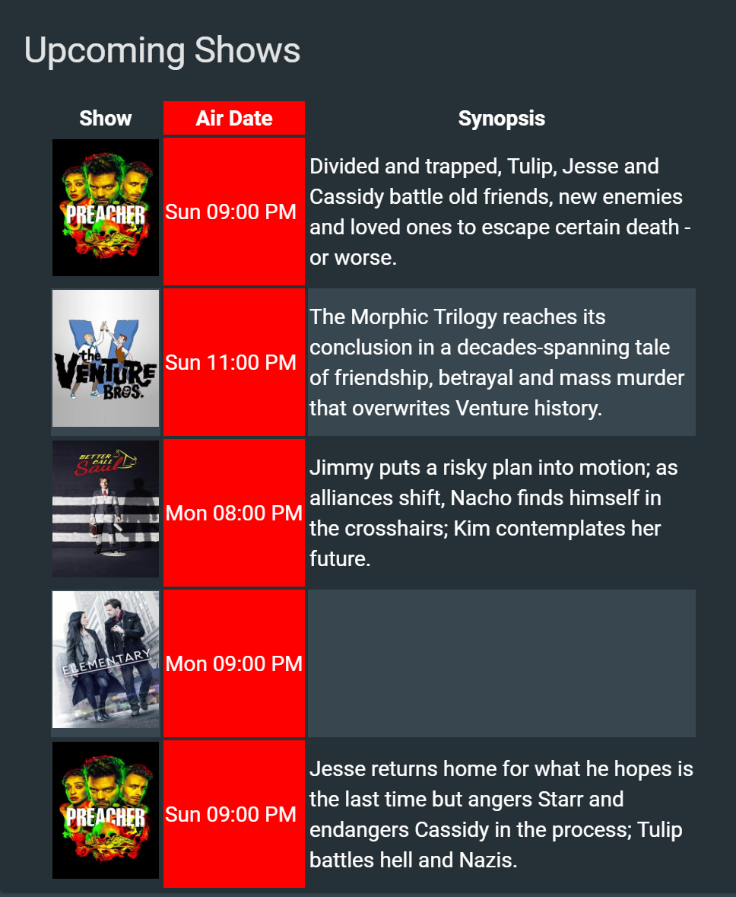

# List Card

A [Home Assistant](https://www.home-assistant.io/) dashboard card that shows a table built from any entity attribute holding a list of objects: [feedparser](https://github.com/custom-components/feedparser) RSS feeds, the [Folder](https://www.home-assistant.io/integrations/folder/) integration, REST / MQTT / multiscrape sensors, and so on.

[![GitHub Release][releases-shield]][releases]
[![License][license-shield]](LICENSE)
[![HACS][hacs-shield]][hacs]
![Project Maintenance][maintenance-shield]



## Installation

### HACS

1. In HACS, open the menu (⋮) → **Custom repositories**.
2. Add `https://github.com/iantrich/list-card` with the **Dashboard** category.
3. Find **List Card** and click **Download**.

To try a pre-release, open List Card in HACS, choose **Redownload**, turn on **Show beta versions**, and pick the beta.

### Manual

1. Download `list-card.js` from the [latest release][releases].
2. Copy it to `<config>/www/list-card.js`.
3. Add `/local/list-card.js` as a **JavaScript module** under **Settings → Dashboards → ⋮ → Resources**.

After installing or upgrading, hard-refresh your browser (or clear the companion app's frontend cache) so the new version loads. The browser console logs the running version as `list-card Version: x.y.z`.

## Visual editor

The card can be configured entirely from the dashboard UI: general options, columns, styles, actions, sort and filter. Everything below can also be written in YAML.

## Card options

| Name             | Type          | Default  | Description                                                                                                 |
| ---------------- | ------------- | -------- | ----------------------------------------------------------------------------------------------------------- |
| `type`           | string        | required | `custom:list-card`                                                                                          |
| `entity`         | string        | required | Entity that holds the list.                                                                                 |
| `feed_attribute` | string        |          | Attribute containing the list (case-sensitive), e.g. `entries`. Nested paths such as `data.items` work too. |
| `title`          | string        |          | Card title.                                                                                                 |
| `columns`        | list          |          | Columns to display. See [Column options](#column-options).                                                  |
| `row_limit`      | number        |          | Maximum number of rows to show.                                                                             |
| `page_size`      | number        |          | Show this many rows per page with previous / next buttons.                                                  |
| `page_interval`  | number        |          | Seconds between automatic page changes (requires `page_size`). Handy for rotating headlines.                |
| `show_header`    | boolean       | `true`   | Show the column header row. It's also hidden automatically when every column title is empty.                |
| `card_height`    | string/number | `300px`  | Maximum height of the list before it scrolls. Numbers are treated as px.                                    |
| `sort`           | object        |          | `value`: field to sort on (nested paths allowed). `reverse`: `true` for descending. Numbers sort naturally. |
| `filter`         | object        |          | Keyword filter. See [Filtering](#filtering).                                                                |
| `empty_message`  | string        |          | Text shown when there are no rows. Without it, an empty card hides itself.                                  |

If the entity or attribute can't be found, the card shows a warning that names the available attributes rather than failing silently. With no columns configured, it lists the fields found in the first row.

## Column options

| Name                | Type          | Default  | Description                                                                                                                                                                                                                             |
| ------------------- | ------------- | -------- | --------------------------------------------------------------------------------------------------------------------------------------------------------------------------------------------------------------------------------------- |
| `title`             | string        |          | Column header.                                                                                                                                                                                                                          |
| `field`             | string        |          | Field to display. Supports nested paths: `links.1.href` or `links[1].href`.                                                                                                                                                             |
| `type`              | string        |          | `image` or `icon`. Leave unset for text.                                                                                                                                                                                                |
| `add_link`          | string        |          | Field containing a URL; the cell becomes a link. `/config/www/...` paths are rewritten to `/local/...`.                                                                                                                                 |
| `link_target`       | string        | `_blank` | Where links open, e.g. `_self` to stay in the current window.                                                                                                                                                                           |
| `template`          | string        |          | Text built from several fields, e.g. `"[[author]] – [[title]]"`.                                                                                                                                                                        |
| `format`            | string        |          | Show a date/timestamp as `date`, `time`, `datetime` or `relative` (e.g. "2 hours ago"), in your Home Assistant language.                                                                                                                |
| `format_options`    | object        |          | [`Intl.DateTimeFormat` options](https://developer.mozilla.org/docs/Web/JavaScript/Reference/Global_Objects/Intl/DateTimeFormat/DateTimeFormat#options) for custom date formats, e.g. `{weekday: long, hour: 2-digit, minute: 2-digit}`. |
| `regex`             | string        |          | Regular expression applied to the text. If it has a capture group, the first group is shown; otherwise the whole match.                                                                                                                 |
| `prefix`            | string        |          | Text added before the value.                                                                                                                                                                                                            |
| `postfix`           | string        |          | Text added after the value.                                                                                                                                                                                                             |
| `full_width`        | boolean       | `false`  | Render this column on its own line spanning the whole card (e.g. a summary under the title). It's left out of the header row.                                                                                                           |
| `style`             | list          |          | CSS applied to the column's cells and header, e.g. `- white-space: normal`.                                                                                                                                                             |
| `icon`              | string        |          | For `type: icon`: a fixed icon such as `mdi:open-in-new` (otherwise the icon name comes from `field`).                                                                                                                                  |
| `column_width`      | string/number | `1fr`    | Width of the column in the list, e.g. `120px`, `2fr`, `20%` or `auto`. A bare number means a share of the free space (`2` = `2fr`). Columns without it split the remaining space equally. |
| `width` / `height`  | string/number | 70 / 90  | Image size. Set both to `auto` to keep the original size, or one to `auto` to keep the aspect ratio.                                                                                                                                    |
| `image_style`       | list          |          | CSS applied to the `` itself, e.g. `- border-radius: 8px`.                                                                                                                                                                         |
| `tap_action`        | object        |          | [Action](https://www.home-assistant.io/dashboards/actions/) to run on tap. Any action type works; `[[field]]` placeholders are filled from the row.                                                                                     |
| `hold_action`       | object        |          | Action to run on press-and-hold.                                                                                                                                                                                                        |
| `double_tap_action` | object        |          | Action to run on double-tap.                                                                                                                                                                                                            |

`format` needs a value that includes a four-digit year. Feedparser's default `date_format` (`%a, %b %d %I:%M %p`) has none, so those dates are shown as-is; set the feedparser `date_format` to something like `%Y-%m-%dT%H:%M:%S%z` to use `format`.

Text order of operations: `template` (or `field`) → `format` → `regex` → `prefix`/`postfix`.

A row is shown when it has a value for at least one configured column.

## Filtering

```yaml
filter:
  include: # keep rows containing at least one of these
    - weather
    - מזג אוויר
  exclude: # then drop rows containing any of these
    - sponsored
  fields: # optional: fields to search (defaults to the column fields)
    - title
    - summary
  case_sensitive: false
```

## Examples

### RSS feed with images, relative dates and summaries

```yaml
type: custom:list-card
entity: sensor.engineering_feed
feed_attribute: entries
title: Engineering Feed
page_size: 5
columns:
  - title: ''
    field: links # picks the image enclosure from feedparser's links list
    type: image
    add_link: link
    width: 60
    height: 60
    image_style:
      - border-radius: 8px
  - title: Title
    field: title
    add_link: link
  - title: Published
    field: published_parsed
    format: relative
  - title: ''
    field: summary
    full_width: true
    style:
      - color: var(--secondary-text-color)
```

The image field depends on the feed. Try `links` (enclosures), `media_content`, `media_thumbnail` or `image`. Use the no-columns warning or Developer Tools → States to see which fields your feed provides.

### Open a link inside Home Assistant instead of the browser

On the companion app, `_blank` links open the system browser. To show the article in a popup instead (requires [browser_mod](https://github.com/thomasloven/hass-browser_mod)):

```yaml
columns:
  - title: Title
    field: title
    tap_action:
      action: fire-dom-event
      browser_mod:
        service: browser_mod.popup
        data:
          size: wide
          content:
            type: iframe
            url: '[[link]]'
```

Or use `tap_action: {action: url, url_path: '[[link]]'}` to open any URL built from the row.

### Call a service with row data

```yaml
columns:
  - title: Play
    field: name
    type: icon
    icon: mdi:play
    tap_action:
      action: perform-action
      perform_action: media_player.play_media
      target:
        entity_id: media_player.living_room
      data:
        media_content_id: '[[url]]'
        media_content_type: music
```

### Folder integration

Using `feed_attribute: file_list` with the [Folder](https://www.home-assistant.io/integrations/folder/) integration produces rows with `path`, `name`, `filename`, `fullpath` and `ext`. Filenames in `YYYYMMDDHHmmSS` form get a readable date as their `name`. With no columns configured, all five are shown and `fullpath` links to the file when it lives under `/config/www`.

```yaml
type: custom:list-card
entity: sensor.snapshots
feed_attribute: file_list
sort:
  value: filename
  reverse: true
columns:
  - title: Snapshot
    field: name
    add_link: fullpath
```

### Data from JSON (REST, MQTT, multiscrape)

Any attribute holding a list (or a dictionary) of objects works, including a JSON string. Put the list in an **attribute**, not the state, because states are limited to 255 characters. For example, with MQTT:

```yaml
mqtt:
  sensor:
    - name: Hostnames
      state_topic: network/dhcp
      value_template: '{{ value_json.hosts | count }}'
      json_attributes_topic: network/dhcp
      json_attributes_template: "{{ {'hosts': value_json.hosts} | tojson }}"
```

```yaml
type: custom:list-card
entity: sensor.hostnames
feed_attribute: hosts
columns:
  - title: Hostname
    field: name
  - title: IP Address
    field: ip
```

The same pattern works for REST (`json_attributes` / `json_attributes_path`) and multiscrape sensors.

## Styling

Each cell has the classes `grid-cell` and the column's field name, so [card-mod](https://github.com/thomasloven/lovelace-card-mod) styles from earlier versions keep working. Full-width cells also get `full-width`, and image/icon cells get `type-image` / `type-icon`.

## Development

```bash
corepack enable
yarn install
yarn start      # dev build + server on http://localhost:5000/list-card.js
yarn build      # production build to dist/list-card.js
yarn test       # unit tests (vitest + happy-dom)
yarn lint
yarn typecheck
```

A VS Code dev container with a preconfigured Home Assistant instance is in [`.devcontainer`](.devcontainer/README.md).

Releases are built by GitHub Actions: publishing a GitHub release tagged `vX.Y.Z` (or `vX.Y.Z-beta.N` as a pre-release) builds the card and attaches `list-card.js`.

[releases-shield]: https://img.shields.io/github/release/iantrich/list-card.svg?style=for-the-badge&include_prereleases
[releases]: https://github.com/iantrich/list-card/releases
[license-shield]: https://img.shields.io/github/license/iantrich/list-card.svg?style=for-the-badge
[hacs-shield]: https://img.shields.io/badge/HACS-Custom-orange.svg?style=for-the-badge
[hacs]: https://hacs.xyz
[maintenance-shield]: https://img.shields.io/badge/maintainer-Ian%20Richardson%20%40iantrich-blue.svg?style=for-the-badge
